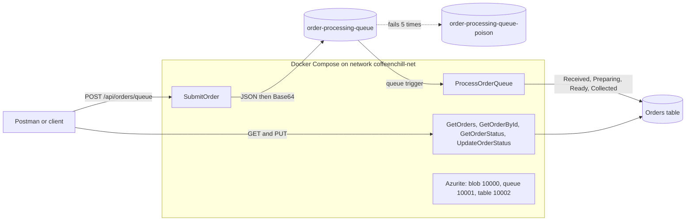
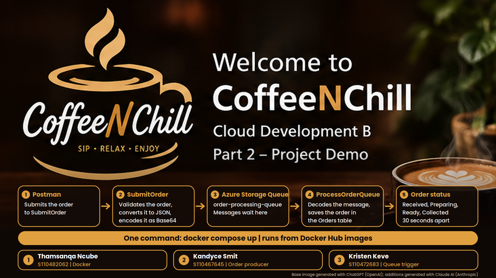
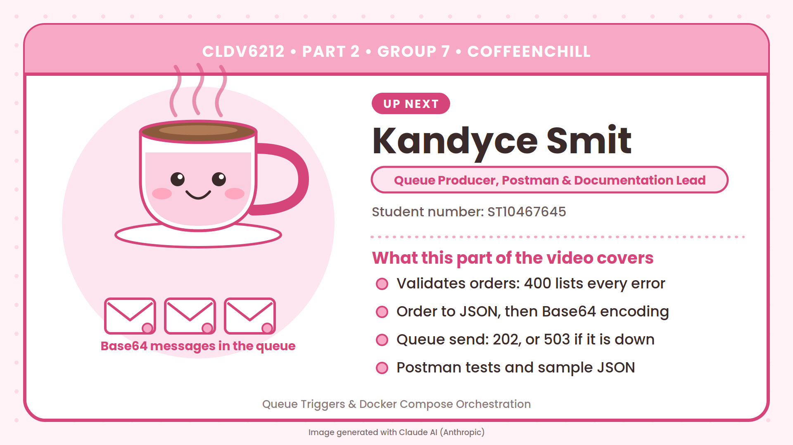
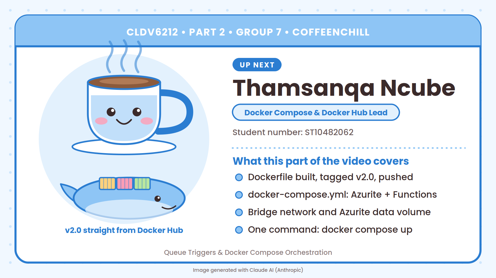
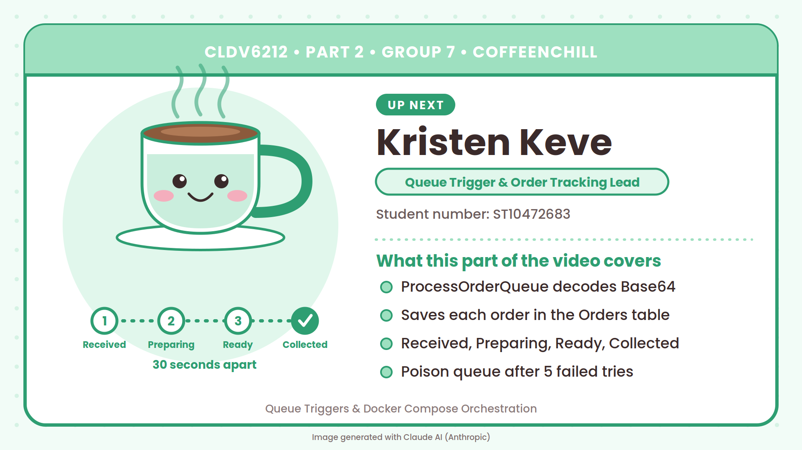

# CoffeeNChill Canteen Management System

**Module:** CLDV6212 (Cloud Development B), The Independent Institute of Education | **Group 7 (ARC)** | **Lecturer:** Farshida Wania

This repository holds the whole POE. **Part 1** (menu, staff documents and Docker images) and **Part 2** (queue triggers and Docker Compose) are kept in separate sections below so each can be marked on its own.

**Jump to:** [Part 1](#part-1--menu-staff-documents-and-docker-v10) | [Part 2](#part-2--queue-triggers-and-docker-compose-v20) | [Contributions and commit evidence](#team-contributions-and-commit-evidence) | [Project structure](#project-structure) | [AI disclosure](#ai-disclosure) | [References](#references)

## Group Members
| Name | Student Number |
|---|---|
| Kandyce Smit | ST10467645 |
| Kristen Keve | ST10472683 |
| Thamsanqa Ncube | ST10482062 |

## Repository Note (private repository and public mirror)
Both parts were built in repositories created through the university's GitHub Classroom, which are **private**. For assessment, each part is **mirrored with its full branch and commit history to a public repository**, the same way as Part 1.

| | Private working repository (GitHub Classroom) | Public repository (submission) |
|---|---|---|
| Part 1 | https://github.com/EMGPSD/cldv6212-g1-2026-poe-part1-st10467645.git | https://github.com/ST10467645/CLDV6212-g1-CoffeeNChill-ArcGroup7.git |
| Part 2 | https://github.com/EMGPSD/Group_1_CLDV6212_Part-2-_Group_7_on_ARC.git | https://github.com/ST10467645/CLDV6212_Part-2-g1-CoffeeNChill-ArcGroup7.git |

What the mirror contains: every branch (`main`, `kandyce-part2-producer`, `kristen-part2-processor`, `thami-part2-compose`), every commit with its original author and date, and the merge commits created when each pull request was merged. What it does **not** contain: the pull request pages and review comments, because GitHub keeps those only in the repository where they were opened. Screenshots of the merged pull requests are in the submission document. The Part 1 project was migrated into the Part 2 repository, so Part 2 contains all Part 1 code unchanged.

## Team Contributions and Commit Evidence
Each member owns one of the three main parts of Part 2 (25 marks each in the brief) and committed from their own GitHub account on their own branch. Work was merged into `main` through pull requests, in an agreed order, so there were no merge conflicts.

The commit and pull request amounts are based on the repository history available at the time that this ReadMe was written

| Member | Branch | Part 2 area | Commits | Pull requests merged |
|---|---|---|---|---|
| Kandyce Smit (ST10467645) | `kandyce-part2-producer` | Queue producer: `SubmitOrder`, DTOs, validation, Base64 encoding, `host.json`, sample payloads, Postman collection, README | 30 | 10 |
| Kristen Keve (ST10472683) | `kristen-part2-processor` | Queue trigger and order tracking: `ProcessOrderQueue`, Orders table, status life cycle, `UpdateOrderStatus`, poison queue | 15 | 11 |
| Thamsanqa Ncube (ST10482062) | `thami-part2-compose` | Docker: `Dockerfile`, `docker-compose.yml`, Docker Hub `v2.0` images, network, volume, Docker Postman checks | 11 | 7 |

Anyone can reproduce the numbers from a clone with these commands (they work in PowerShell, Command Prompt and Git Bash):
```text
git fetch --all
git shortlog -sn --all --no-merges
git log --all --no-merges --format="%h  %ad  %an  %s" --date=short
git log --all --graph --oneline --decorate
```
GitHub's Insights > Contributors page only counts commits whose e-mail address is linked to a GitHub account, so the terminal output above is the complete record.

Branch and commit conventions: one branch per person and feature area, commit messages in the form `feat:`, `fix:`, `docs:`, `test:` followed by what changed (for example `feat: add queue-triggered order processing with status lifecycle`), commits spread over several days, and every branch merged by pull request.

---

# Part 1 — Menu, Staff Documents and Docker (v1.0)

## Project Overview
CoffeeNChill is a campus canteen that struggles with queues during lecture breaks. Part 1 replaced the paper menu and filing cabinet with Azure Table Storage, Azure Blob Storage and HTTP-triggered Azure Functions running against the Azurite emulator (Microsoft Learn, 2022; Microsoft Learn, 2025a; Microsoft Learn, 2025b; Microsoft Learn, 2026e).

## Part 1 Features
### Menu Management (Kandyce)
The Menu Management feature uses Microsoft Azure's Table Storage to digitalise CoffeeNChill's chalkboard menu for their coffee shop. With five HTTP triggered Azure Functions that handle full CRUD operations of the menu items (creating, reading, updating, and deleting): create a new menu item (Microsoft Learn, 2025b), read all available menu items (Microsoft Learn, 2026c), read only specific menu items by category (Microsoft Learn, 2022), and updating and deleting menu items (Microsoft Learn, 2026c). This storage system stores each menu item with its category as the Partition Key and a unique SKU as the Row Key. In addition, it includes name, description, price and status fields for each menu item. Validation logic has been implemented in each function to validate the input data when creating a new record (validation for bad request 400 when missing data exists). Also, there have been existence checks included for update and delete operations to prevent unexpected errors from occurring (return a 404 Not Found instead of an unhandled exception).

### Staff Documents (Kristen)
The Staff Documents feature allows the canteen staff to upload, view and download important documents using Azure Blob Storage. When a file is uploaded the system checks that it's either a PDF, PNG or JPEG before storing it, so other file types can't be uploaded by mistake (Microsoft Learn, 2026f). The content type is stored with each file so that downloads report the correct file type (Microsoft Learn, 2026u; Microsoft Learn, 2026v). All the uploaded documents are stored in a container called "staff-docs" and users can list every file that's currently stored, along with its name, size and the date it was last modified (Microsoft Learn, 2026e). Files are also downloaded using streaming, which sends the file to the user instead of loading the whole thing into memory first making it more efficient for larger files (Microsoft Learn, 2026d). Each function also includes error handling and logging so any problems such as a missing file or a storage connection issue are caught and logged instead of crashing the app.

### Docker (Thami)
My contribution to Part 1 of the POE was the Docker setup. I wrote a multi-stage Dockerfile for the Azure Functions project, the beginning stage used the full .NET 9 SDK image to compile and publish the code, the second stage then copied only the compiled output into the lightweight Azure Functions runtime image, keeping the final image small and clean (Microsoft Learn, 2026a) (Microsoft Learn, 2026b). I also built and tagged both images with version tag v1.0 and published them directly to Docker Hub under the account st10482062: "coffeenchill-functions" for the Azure Functions application and "coffeenchill-azurite" as a re-tagged instance of the official Azurite image (Docker, 2026a), (Docker, 2026b), (Docker, 2026c), (Docker, 2026d). Azurite also runs in its own standalone Docker container with the "--skipApiVersionCheck" flag bound to ports 10000, 10001, and 10002, and both containers communicate with each other over a shared Docker network called "coffeenchill-net" (Microsoft Learn, 2025a), (Microsoft Learn, 2026b).

## Part 1 API Endpoints
### Menu (Azure Table Storage)
| Method | Route | Description |
|---|---|---|
| POST | /api/menu | Create a new menu item |
| GET | /api/menu | Get all menu items |
| GET | /api/menu/category/{category} | Get menu items by category |
| PUT | /api/menu/{category}/{id} | Update a menu item |
| DELETE | /api/menu/{category}/{id} | Delete a menu item |

### Staff Documents (Azure Blob Storage)
| Method | Route | Description |
|---|---|---|
| POST | /api/documents/upload | Upload a staff document (multipart/form-data) |
| GET | /api/documents | List staff documents with metadata |
| GET | /api/documents/download/{fileName} | Download a staff document |

## Part 1 Docker Images (v1.0)
Built, tagged and pushed to public Docker Hub repositories (Docker, 2026a; Docker, 2026b). Part 1 runs on port **7071** (`http://localhost:7071/api`).
- Functions: https://hub.docker.com/r/st10482062/coffeenchill-functions?tag=v1.0 (`v1.0`)
- Azurite: https://hub.docker.com/r/st10482062/coffeenchill-azurite?tag=v1.0 (`v1.0`)

## Part 1 Testing
Postman collections and the environment are in `docs/Postman Collection/Part 1/`: `CoffeeNChill Part 1 - Successful Tests`, `CoffeeNChill Part 1 - Invalid Tests` and the `Local Azurite` environment (`baseUrl` = `http://localhost:7071/api`). Import them, select **Local Azurite** and run each collection. Every request has a saved test script that follows Postman's test-script pattern (Postman, 2025).

Sample staff documents are in `docs/staff-docs_TestDocuments/` (three PDFs, an allowed type, and one `.txt`, which is not an allowed upload type). Postman does not export attached files, only a local path, so re-select a file in the Body tab of the Upload request before running it.

## Part 1 Video and Document
- Video: https://youtu.be/suzi50aHtrU?si=HFO_WMRrx3LRTdMr
- Submission document: [CLDV6212_Part_1_Final_Submission.pdf](docs/Final%20Submission%20Document/CLDV6212_Part_1_Final_Submission.pdf)

---

# Part 2 — Queue Triggers and Docker Compose (v2.0)

## What the System Does
Part 2 adds **asynchronous order processing**. A customer's order is validated and placed on an Azure Storage Queue, and a background function picks it up, saves it in an `Orders` table and moves it through its life cycle (Microsoft Learn, 2026g). Putting a queue between the customer and the kitchen means the customer gets an instant reply and orders are handled one by one instead of crashing the system at peak times (Mrzyglod and Camden, 2020). The whole stack starts with one `docker compose up` using version-tagged images pulled from Docker Hub (Docker, 2026f).

1. **SubmitOrder** (HTTP) checks the order, builds the JSON message, encodes it as Base64 and puts it on `order-processing-queue`. It answers **202 Accepted** straight away.
2. **ProcessOrderQueue** (queue trigger) decodes the Base64 back to JSON, reads it into an order, checks it again and saves it to the `Orders` table with status `Received`.
3. The same function then waits 30 seconds between each status and updates the table row: `Received` → `Preparing` → `Ready` → `Collected`. Every step is written to the log.
4. If a message cannot be processed it is retried and, after 5 attempts, Azure moves it to `order-processing-queue-poison`.

## Changelog (Part 2)
- **Added** `POST /api/orders/queue` (`SubmitOrder`): validation, JSON message, Base64 encoding, UTC timestamp and order number, 202 Accepted, error handling for an unavailable queue.
- **Added** `ProcessOrderQueue`: queue-triggered function with Base64 decoding, saving to the `Orders` table and the 30-second status life cycle.
- **Added** `GET /api/orders`, `GET /api/orders/{orderDate}/{orderId}`, `GET /api/orders/{orderId}` (status only) and `PUT /api/orders/{orderDate}/{orderId}/status`.
- **Added** poison queue handling (`order-processing-queue-poison`) with `maxDequeueCount` set to 5 in `host.json`, and an optional `ENABLE_POISON_TEST` switch.
- **Added** `docker-compose.yml`: Azurite and Functions, custom bridge network `coffeenchill-net`, volume `azurite-data`, Docker Hub `v2.0` images, API on port **7071**.
- **Added** DTO classes in the `DTOs` folder (requests, responses and mappers) and sample JSON payloads in `docs/sample-payloads/`.
- **Added** a new Postman collection and a new `baseUrl` environment for port 7071.
- **Changed** `host.json`: `messageEncoding` is `none` (Base64 is done in our code), `maxPollingInterval` 2 seconds, `maxDequeueCount` 5.
- **Changed** code-comment attributions standardised to Harvard referencing.
- **Removed** the unused `Function1` template.
- **Kept** all Part 1 endpoints working and unchanged.

## Architecture

`docker compose up` starts two containers, `azurite` and `functions`, on the network `coffeenchill-net`. The functions container reaches Azurite by the service name `azurite`.

## Prerequisites
- Docker Desktop
- Postman
- Git
- Azure Storage Explorer (to show the queue and the Orders table)
- Visual Studio 2022 (Azure development workload) and the .NET 9 SDK, only to run from source

## Quick Start (one command)
```text
git clone https://github.com/ST10467645/CLDV6212_Part-2-g1-CoffeeNChill-ArcGroup7.git
cd CLDV6212_Part-2-g1-CoffeeNChill-ArcGroup7
docker compose up
```
1. Docker pulls both `v2.0` images from Docker Hub (nothing is built locally), creates the network and volume and starts the stack. A 404 from Azurite in the first seconds is normal.
2. Wait until the functions log lists the functions and says the host has started.
3. The API is at **`http://localhost:7071/api`**. Visual Studio must **not** be running.
4. Stop with `Ctrl+C`, then `docker compose down`. Add `-v` only if you want to delete the stored Azurite data.
5. If a port is busy, run `docker ps -a` and remove old CoffeeNChill containers with `docker stop` and `docker rm`.

Connect Azure Storage Explorer with **Local & attached > Storage Accounts > Emulator - Default Ports (Key)** to see the `order-processing-queue` queue and the `Orders` table that the containers are using.

## What Is In docker-compose.yml
| Setting | Value | Why |
|---|---|---|
| `image` | `st10482062/coffeenchill-functions:v2.0` and `st10482062/coffeenchill-azurite:v2.0` | Compose pulls the exact published version from Docker Hub (Docker, 2026f) |
| `build` | not used | The images come from Docker Hub, nothing is built on the marker's machine |
| `ports` | `7071:80` (functions), `10000`, `10001`, `10002` (Azurite) | 7071 on the computer maps to port 80 inside the functions container. Azurite uses blob 10000, queue 10001, table 10002 |
| `networks` | custom bridge `coffeenchill-net` | The containers find each other by service name (`azurite`), not `localhost` (Docker, 2026e) |
| `volumes` | `azurite-data:/data` | Queue and table data survive `docker compose down` (Docker, 2026g) |
| `environment` | `AzureWebJobsStorage` (points to `azurite`), `STATUS_STEP_DELAY_SECONDS` = 30, `ENABLE_POISON_TEST` = false | Connection string, seconds between statuses, and the optional failure switch |
| `depends_on` | `azurite` | Azurite is started before the functions |
| `restart` | `unless-stopped` | The functions container retries if Azurite is not ready yet |

The images were built from the multi-stage `Dockerfile`, tagged `v2.0` and pushed to Docker Hub (Docker, 2026c; Docker, 2026d; Docker, 2026h; Microsoft Learn, 2026b). The commands are in `docker-commands.md`.

## Docker Hub Images
- Functions: https://hub.docker.com/r/st10482062/coffeenchill-functions (`v1.0`, `v2.0`)
- Azurite: https://hub.docker.com/r/st10482062/coffeenchill-azurite (`v1.0`, `v2.0`)

## Part 2 API Endpoints
The base URL is `http://localhost:7071/api`, both in Docker and when running from Visual Studio (never run both at once).

| Method | Route | Description | Success | Errors |
|---|---|---|---|---|
| POST | `/api/orders/queue` | Validate an order and place it on `order-processing-queue` | 202 | 400, 503, 500 |
| GET | `/api/orders` | List orders (optional `?status=Received`) | 200 | 400, 500 |
| GET | `/api/orders/{orderDate}/{orderId}` | Get one order from the table | 200 | 404 |
| GET | `/api/orders/{orderId}` | Get only the order id and current status | 200 | 404 |
| PUT | `/api/orders/{orderDate}/{orderId}/status` | Move an order to the next status (`{"Status":"Preparing"}`) | 200 | 400, 404 |
| Queue | `ProcessOrderQueue` | Saves queued orders to `Orders` and tracks the status | - | poison queue |

Example request body (more in `docs/sample-payloads/`):
```json
{
  "CustomerName": "Jane Smith",
  "SelectedItemSKUs": ["COF-001", "PAS-104"],
  "TotalPrice": 65.00
}
```
`OrderId` and `OrderTimestamp` may be left out. The server then generates the order number (`ORD-2026-XXXXXX`) and the UTC timestamp.

## How Bad or Incomplete Data Is Handled
| What the client sends | What the system does |
|---|---|
| Empty body or text that is not JSON | 400 Bad Request, nothing is queued |
| Customer name missing or blank | 400 with an `errors` list, nothing is queued |
| No items, or a blank item SKU | 400 with an `errors` list, nothing is queued |
| Total price 0 or negative | 400 with an `errors` list, nothing is queued |
| Several problems at once | One 400 that lists all of them |
| Valid order | 202 Accepted with the order id and date, the message is queued |
| Queue or Azurite not reachable | The error is caught and logged, the reply is 503 Service Unavailable within a few seconds (500 for any other unexpected error), the app does not crash |
| A bad message reaches the queue directly (for example added by hand) | The trigger tries 5 times, then Azure moves it to `order-processing-queue-poison`. The app keeps running |
| PUT with an unknown status word, or skipping a step | 400 Bad Request |
| PUT or GET for an order that does not exist | 404 Not Found |

## Queue Settings (host.json)
```json
{
  "version": "2.0",
  "extensions": {
    "queues": {
      "messageEncoding": "none",
      "maxPollingInterval": "00:00:02",
      "maxDequeueCount": 5
    }
  }
}
```
- `messageEncoding: none`: the queue stores exactly the text we send. The Base64 step is done in our own code, so it can be shown and explained.
- `maxPollingInterval`: the trigger checks the queue every 2 seconds at most, so orders start quickly.
- `maxDequeueCount: 5`: after 5 failed attempts a message goes to the poison queue (Microsoft Learn, 2026l).

## JSON and Base64
The producer turns the order into a JSON string and then into Base64 text before queueing it (Microsoft Learn, 2026w). The trigger turns the Base64 text back into bytes and then into the JSON string before reading it into an order (Microsoft Learn, 2026o; Microsoft Learn, 2026p; Microsoft Learn, 2026s). **Base64 is an encoding, not encryption.** It only changes how the data is written so it can be stored and sent safely. Anyone can decode it.

## Order Status Life Cycle
`Received` → `Preparing` → `Ready` → `Collected`. The function waits **30 seconds** between statuses to simulate the kitchen (the setting is `STATUS_STEP_DELAY_SECONDS`, default 30). The lecturer said a timer can be used; we used an asynchronous `Task.Delay`, which does the same job without blocking the thread (Microsoft Learn, 2026j). The sample payloads are in `docs/sample-payloads/`. The stages are visible in the container log and in the `Orders` table (PartitionKey = order date `yyyy-MM-dd`, RowKey = order id).

## Part 2 Feature Descriptions
### Order Queue Producer (Kandyce)
The order producer is the first half of the asynchronous ordering workflow. `SubmitOrder` is an HTTP-triggered function that accepts a new order as JSON at `POST /api/orders/queue` (Microsoft Learn, 2025b). Before anything is queued, it checks that the body is valid JSON, that the customer name is filled in, that at least one item is selected with no blank SKUs and that the total price is above zero. If anything is wrong, a 400 response lists every problem at once so the client can fix them in one go. When the client leaves them out, the server generates the order number and a UTC timestamp. The validated order is serialised to a JSON string and encoded to Base64 in the code, then sent to `order-processing-queue` with the Azure Storage Queues client library (Microsoft Learn, 2026q; Microsoft Learn, 2026w). `host.json` uses `messageEncoding: none` so that the queue stores exactly the Base64 text we send. If the queue cannot be reached, the function catches the error (Microsoft Learn, 2026r), logs it and returns a 503 Service Unavailable within a few seconds instead of crashing. On success it answers 202 Accepted straight away, because the order is processed later in the background (IIE, 2026). `GetOrders`, `GetOrderById` and `GetOrderStatus` read the `Orders` table and return a clean response object (DTO), with a 404 for an unknown order and a 400 for an invalid status filter (Microsoft Learn, 2026c).

### Queue Trigger and Order Tracking (Kristen)
`ProcessOrderQueue` is the second half of the workflow and runs automatically whenever a message arrives on `order-processing-queue` (Microsoft Learn, 2026g). It decodes the Base64 message back to JSON (Microsoft Learn, 2026o; Microsoft Learn, 2026p), reads it into an `Order` object (Microsoft Learn, 2026s) and saves an entry in the `Orders` table with the order date as the PartitionKey, the OrderId as the RowKey and the status `Received` (Microsoft Learn, 2026c; Microsoft Learn, 2026k). It then simulates the barista life cycle by waiting 30 seconds between statuses (Microsoft Learn, 2026j; Microsoft Learn, 2026m; Microsoft Learn, 2026n) and moving the order through `Preparing` and `Ready` to `Collected`, updating the table row at each step and logging every change. A `PUT` endpoint, `UpdateOrderStatus`, lets staff move an order forward one step at a time and returns a 400 for an invalid or skipped status and a 404 for an unknown order (Microsoft Learn, 2026t). If a message cannot be processed, the error is logged and the exception is rethrown, so after 5 attempts the runtime moves the message to `order-processing-queue-poison` instead of blocking the queue (Microsoft Learn, 2026l).

### Docker Compose Orchestration (Thami)
One `docker-compose.yml` in the repository root starts the Azurite emulator and the Functions app together with a single `docker compose up` (Docker, 2026f). Both services use version-tagged `v2.0` images from Docker Hub, so a clean machine only needs Docker to run the whole system. The services share a custom bridge network so the Functions container reaches Azurite by the service name `azurite` rather than `localhost` (Docker, 2026e), and a named volume keeps Azurite's data when the containers are removed (Docker, 2026g). The images were built from the multi-stage Dockerfile, tagged `v2.0` and pushed to Docker Hub (Docker, 2026c; Docker, 2026d; Docker, 2026h; Microsoft Learn, 2026b). I also added the Docker checks to the Postman collection, which run with Visual Studio closed.

## Part 2 Testing
The Part 2 Postman collection is in `docs/Postman Collection/Part 2/`. It is a separate collection from Part 1: the collection **CoffeeNChill Part 2** and the environment **Docker Compose (7071)**, whose `baseUrl` is `http://localhost:7071/api`. Individual member test collections are in `docs/Postman Collection/Part 2/Individual Member Tests/`.

1. Start the stack with `docker compose up` and close Visual Studio.
2. In Postman import the collection and the environment, and select **Docker Compose (7071)**.
3. Run the collection with the Runner (delay 3000 ms). Every request has a saved test script that follows Postman's test-script pattern (Postman, 2025).
4. Open Azure Storage Explorer and check the `Orders` table: the new order moves through the four statuses.

| Folder | What it tests |
|---|---|
| Queue Producer | valid order (202) and invalid orders: missing name, empty items, price 0 (400) |
| Order Tracking | order saved in the table, `GET` by id and by status |
| Status Updates | `PUT` next status (200), skipped step (400), unknown word (400), unknown order (404) |
| Manual checks | final status is `Collected` about 100 seconds after the order (not part of the automatic run) |
| Docker Checks | the same tests against the Docker Compose stack with Visual Studio closed |
| Poison queue | see below (manual) |

**Poison queue demonstration.** Because the app works, no message fails and `order-processing-queue-poison` does **not exist yet**: Azure creates it only when a message fails. To prove it works, open the `order-processing-queue` queue in Azure Storage Explorer, choose **Add Message** and type `this is not valid JSON or Base64`. The trigger fails 5 times (visible in the log) and the message appears in the new `order-processing-queue-poison` queue. `SubmitOrder` blocks bad data with a 400, so adding the message by hand is how we test the trigger's own defence. (A second method: set `ENABLE_POISON_TEST` to `true` for the `functions` service, run `docker compose up -d`, place an order, then set it back to `false`.)

**Seeing a message wait in the queue (Visual Studio only):** add `"AzureWebJobs.ProcessOrderQueue.Disabled": "true"` to `Values` in `local.settings.json`, run the app, place an order and open the queue in Storage Explorer. Remove the line afterwards.

**Evidence:** screenshots are in `docs/screenshots_part2/` (one folder per member) and in the submission document.

## Part 2 Video and Document
- Video: https://youtu.be/iP3w9mEHbPM (shows `docker compose up`, the application starting, messages moving through the queue into the Orders table, and the Postman tests running)
- Submission document: [CLDV6212 CoffeeNChill Part 2.pdf](docs/Final%20Submission%20Document/Part2/CLDV6212%20CoffeeNChill%20Part%202.pdf)

### Video title cards
The video opens and closes with an image and each presenter is introduced by a title card. All five images are AI-generated (see the image credits under AI Disclosure).

| Intro | Outro |
|---|---|
|  |  |

| Kandyce | Thami | Kristen |
|---|---|---|
|  |  |  |

*Intro and outro images: generated with ChatGPT (OpenAI). Presenter title cards: generated with Claude (Anthropic). Prompts written by the team.*

Set the video quality to 1080p HD in YouTube's settings; it defaults to a lower resolution.

---

## Running From Source (optional)
1. Start Azurite in Docker:
```text
docker compose up azurite -d
```
2. Make sure `local.settings.json` is in the project root with `"AzureWebJobsStorage": "UseDevelopmentStorage=true"` and `"FUNCTIONS_WORKER_RUNTIME": "dotnet-isolated"`.
3. Open the solution in Visual Studio and press Ctrl+F5. The API is then at `http://localhost:7071/api`.

Never run Visual Studio and the full `docker compose up` at the same time. Both would read the same queue and the Azurite ports would clash.

## Project Structure
```text
CoffeeNChillFunctions Part 2/          (repository root)
├── DTOs/                              request, response and mapper classes
├── Functions/
│   ├── CreateMenuItem.cs   DeleteMenuItem.cs   GetAllMenuItems.cs   GetMenuItemsByCategory.cs   UpdateMenuItem.cs
│   ├── UploadStaffDocument.cs   ListStaffDocuments.cs   DownloadStaffDocument.cs
│   ├── SubmitOrder.cs   ProcessOrderQueue.cs   GetOrders.cs   GetOrderById.cs   GetOrderStatus.cs   UpdateOrderStatus.cs
├── Models/                            MenuItem.cs, Order.cs, OrderEntity.cs, OrderStatus.cs
├── docs/
│   ├── docker-screenshots/
│   ├── Final Submission Document/     Part 1 and Part 2 PDFs
│   ├── Postman Collection/
│   │   ├── Part 1/
│   │   └── Part 2/                    (includes Individual Member Tests/)
│   ├── sample-payloads/               JSON order examples
│   ├── screenshots_part2/             Kandyce/, kristen/, Thami/
│   ├── staff-docs_TestDocuments/
│   └── video-assets/                  Part2_Intro_Image.png, Outropng.png, Part2_Card_IntroToKandyce.png, Part2_Card_IntroToThami.png, Part2_Card_IntroToKristen.png
├── .gitignore
├── CoffeeNChillFunctions.csproj
├── CoffeeNChillFunctions.slnx
├── Dockerfile
├── docker-commands.md
├── docker-compose.yml
├── host.json
├── local.settings.json
├── Program.cs
└── README.md
```
`bin/` and `obj/` are build output and are excluded through `.gitignore`. Every source file starts with an attribution comment that uses the same reference letters as the list below; the full attribution register is in the submission document.

## Important Notes
- **Storage:** the brief mentions Azure File Share. On lecturer guidance, staff documents use Azure Blob Storage (container `staff-docs`) because File Share emulation is not reliably supported in Azurite.
- **.NET version:** the project was scaffolded on .NET 10 and downgraded to .NET 9 for compatibility with the official Azure Functions Docker base images.
- **Ports:** Azurite serves Blob on 10000, Queue on 10001 and Table on 10002. The API is on 7071 both in Docker and in Visual Studio, so never run both at once.
- **Secrets:** the only connection string in the repository is the public Azurite development key, which is the same on every machine.

## AI Disclosure
AI tools were used during this project:
- **Claude (Anthropic)** was used to generate the three presenter title cards shown in the video (see the image credits below).
- **ChatGPT (OpenAI)** was used to generate the video intro and outro images.

### Image credits (AI-generated images)
| Image (file in `docs/video-assets/`) | Where it is used | Generated with | Month | Prompt written by |
|---|---|---|---|---|
| `Part2_Intro_Image.png` | Start of the video | ChatGPT (OpenAI) + Claude (Anthropic) | October 2026 | Kandyce Smit |
| `Outropng.png` | End of the video | ChatGPT (OpenAI) | October 2026 | Kandyce Smit |
| `Part2_Card_IntroToKandyce.png` | Title card before Kandyce's producer segment: pink coffee-cup mascot with envelopes for the Base64 queue messages | Claude (Anthropic) | October 2026 | Kandyce Smit |
| `Part2_Card_IntroToThami.png` | Title card before Thami's Docker segment: blue coffee-cup mascot with a whale carrying containers for the v2.0 Docker Hub images | Claude (Anthropic) | October 2026 | Kandyce Smit |
| `Part2_Card_IntroToKristen.png` | Title card before Kristen's trigger segment: green coffee-cup mascot with the four status steps, Received to Collected, 30 seconds apart | Claude (Anthropic) | October 2026 | Kandyce Smit |

The images are decorative video graphics. They contain no code or results, and the text on the cards (names, student numbers, roles) was checked against the contributions table above. They are credited here and not in the reference list because they are our own AI-generated material and not published sources.

## References
Docker, 2026a. Build and push your first image. [Online]
Available at: https://docs.docker.com/get-started/introduction/build-and-push-first-image/
[Accessed 04 September 2026].

Docker, 2026b. Docker Hub quickstart. [Online]
Available at: https://docs.docker.com/docker-hub/quickstart/
[Accessed 04 September 2026].

Docker, 2026c. Push images to a repository. [Online]
Available at: https://docs.docker.com/docker-hub/repos/manage/hub-images/push/
[Accessed 04 September 2026].

Docker, 2026d. Build, tag, and publish an image. [Online]
Available at: https://docs.docker.com/get-started/docker-concepts/building-images/build-tag-and-publish-an-image/
[Accessed 04 September 2026].

Docker, 2026e. Define and manage networks in Docker Compose. [Online]
Available at: https://docs.docker.com/reference/compose-file/networks/
[Accessed 29 September 2026].

Docker, 2026f. Compose file reference. [Online]
Available at: https://docs.docker.com/reference/compose-file/
[Accessed 29 September 2026].

Docker, 2026g. Define and manage volumes in Docker Compose. [Online]
Available at: https://docs.docker.com/reference/compose-file/volumes/
[Accessed 29 September 2026].

Docker, 2026h. Dockerfile reference. [Online]
Available at: https://docs.docker.com/reference/dockerfile/
[Accessed 09 October 2026].

IIE, 2026. CLDV6212 lecturer course examples, notes and POE brief (Parts 1 and 2): Azure Functions, Table and Blob Storage, queue triggers and Docker Compose. [Lecture notes]. Cloud Development B. The Independent Institute of Education.

Microsoft Learn, 2022. What is Azure Table storage? [Online]
Available at: https://learn.microsoft.com/en-us/azure/storage/tables/table-storage-overview
[Accessed 04 September 2026].

Microsoft Learn, 2025a. Install and run Azurite emulator. [Online]
Available at: https://learn.microsoft.com/en-us/azure/storage/common/storage-install-azurite
[Accessed 04 September 2026].

Microsoft Learn, 2025b. Azure Functions HTTP trigger. [Online]
Available at: https://learn.microsoft.com/en-us/azure/azure-functions/functions-bindings-http-webhook-trigger?tabs=python-v2%2Cisolated-process%2Cnodejsv4%2Cfunctionsv2&pivots=programming-language-csharp
[Accessed 04 September 2026].

Microsoft Learn, 2026a. Create your first containerized Azure Functions. [Online]
Available at: https://learn.microsoft.com/en-us/azure/azure-functions/functions-deploy-container
[Accessed 04 September 2026].

Microsoft Learn, 2026b. Work with containers and Azure Functions. [Online]
Available at: https://learn.microsoft.com/en-us/azure/azure-functions/functions-how-to-custom-container
[Accessed 04 September 2026].

Microsoft Learn, 2026c. Azure Tables client library for .NET - version 12.12.0. [Online]
Available at: https://learn.microsoft.com/en-us/dotnet/api/overview/azure/data.tables-readme?view=azure-dotnet
[Accessed 04 September 2026].

Microsoft Learn, 2026d. Download a blob with .NET. [Online]
Available at: https://learn.microsoft.com/en-us/azure/storage/blobs/storage-blob-download
[Accessed 04 September 2026].

Microsoft Learn, 2026e. Introduction to Azure Blob Storage. [Online]
Available at: https://learn.microsoft.com/en-us/azure/storage/blobs/storage-blobs-introduction
[Accessed 04 September 2026].

Microsoft Learn, 2026f. MultipartReader Class. [Online]
Available at: https://learn.microsoft.com/en-us/dotnet/api/microsoft.aspnetcore.webutilities.multipartreader?view=aspnetcore-10.0
[Accessed 04 September 2026].

Microsoft Learn, 2026g. Azure Queue storage trigger for Azure Functions. [Online]
Available at: https://learn.microsoft.com/en-us/azure/azure-functions/functions-bindings-storage-queue-trigger
[Accessed 29 September 2026].

Microsoft Learn, 2026h. Conditional operator. [Online]
Available at: https://learn.microsoft.com/en-us/dotnet/csharp/language-reference/operators/conditional-operator
[Accessed 30 September 2026].

Microsoft Learn, 2026i. String.Join Method. [Online]
Available at: https://learn.microsoft.com/en-us/dotnet/api/system.string.join?view=net-10.0
[Accessed 30 September 2026].

Microsoft Learn, 2026j. Task.Delay Method. [Online]
Available at: https://learn.microsoft.com/en-us/dotnet/api/system.threading.tasks.task.delay?view=net-10.0
[Accessed 01 October 2026].

Microsoft Learn, 2026k. TableClient.UpsertEntityAsync Method. [Online]
Available at: https://learn.microsoft.com/en-us/dotnet/api/azure.data.tables.tableclient.upsertentityasync?view=azure-dotnet
[Accessed 01 October 2026].

Microsoft Learn, 2026l. Poison messages in Azure Functions. [Online]
Available at: https://learn.microsoft.com/en-us/azure/azure-functions/functions-bindings-storage-queue-trigger#poison-messages
[Accessed 01 October 2026].

Microsoft Learn, 2026m. Environment.GetEnvironmentVariable Method. [Online]
Available at: https://learn.microsoft.com/en-us/dotnet/api/system.environment.getenvironmentvariable?view=net-10.0
[Accessed 01 October 2026].

Microsoft Learn, 2026n. Int32.TryParse Method. [Online]
Available at: https://learn.microsoft.com/en-us/dotnet/api/system.int32.tryparse?view=net-10.0
[Accessed 05 October 2026].

Microsoft Learn, 2026o. Convert.FromBase64String Method. [Online]
Available at: https://learn.microsoft.com/en-us/dotnet/api/system.convert.frombase64string?view=net-10.0
[Accessed 08 October 2026].

Microsoft Learn, 2026p. Encoding.GetString Method. [Online]
Available at: https://learn.microsoft.com/en-us/dotnet/api/system.text.encoding.getstring?view=net-10.0
[Accessed 08 October 2026].

Microsoft Learn, 2026q. Azure Queue Storage client library for .NET. [Online]
Available at: https://learn.microsoft.com/en-us/dotnet/api/overview/azure/storage.queues-readme?view=azure-dotnet
[Accessed 04 September 2026].

Microsoft Learn, 2026r. RequestFailedException Class. [Online]
Available at: https://learn.microsoft.com/en-us/dotnet/api/azure.requestfailedexception?view=azure-dotnet
[Accessed 01 October 2026].

Microsoft Learn, 2026s. JsonSerializer.Deserialize Method. [Online]
Available at: https://learn.microsoft.com/en-us/dotnet/api/system.text.json.jsonserializer.deserialize?view=net-10.0
[Accessed 05 October 2026].

Microsoft Learn, 2026t. StreamReader.ReadToEndAsync Method. [Online]
Available at: https://learn.microsoft.com/en-us/dotnet/api/system.io.streamreader.readtoendasync?view=net-10.0
[Accessed 05 October 2026].

Microsoft Learn, 2026u. BlobHttpHeaders Class. [Online]
Available at: https://learn.microsoft.com/en-us/dotnet/api/azure.storage.blobs.models.blobhttpheaders?view=azure-dotnet
[Accessed 04 September 2026].

Microsoft Learn, 2026v. BlobUploadOptions.HttpHeaders Property. [Online]
Available at: https://learn.microsoft.com/en-us/dotnet/api/azure.storage.blobs.models.blobuploadoptions.httpheaders?view=azure-dotnet
[Accessed 04 September 2026].

Microsoft Learn, 2026w. Convert.ToBase64String Method. [Online]
Available at: https://learn.microsoft.com/en-us/dotnet/api/system.convert.tobase64string?view=net-10.0
[Accessed 09 October 2026].

Mrzyglod, K. and Camden, R., 2020. Azure for Developers: Implement rich Azure PaaS ecosystems using containers, serverless services, and storage solutions. 2nd ed. Birmingham: Packt Publishing.

Postman, 2025. Write scripts to test API response data in Postman. [Online]
Available at: https://learning.postman.com/docs/tests-and-scripts/write-scripts/test-scripts/
[Accessed 01 September 2026].
